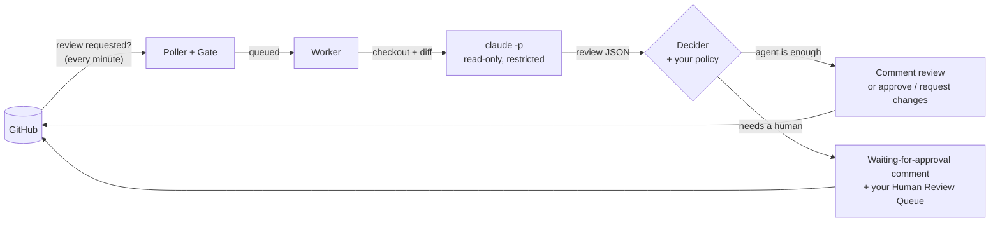

<div align="center">

# PRowl

**Pull-request reviews, around the clock — by your own Claude, under your own rules.**

[](https://github.com/AmirhosseinBahrani/prowl/actions/workflows/ci.yml)
[](#license)


</div>

PRowl watches GitHub for pull requests where **you** are a requested reviewer, reviews them with
your local [Claude Code](https://claude.com/claude-code) CLI against a **Review Policy you write**,
and then either posts the review on its own or flags the PR as **waiting for your approval** —
depending on what the change touches.

It runs as a small background service on your laptop or an always-on server, and you work with it
from a terminal UI that is just as happy over SSH.

```
 PRowl  pull-request reviews, around the clock
 1 Queue 2 │ 2 Feed │ 3 Reviews │ 4 History │ 5 Policy │ 6 Repos │ 7 Settings
┌ Queue ───────────────────────────────────────────────────────────────────────────┐
│severity   PR                title                         why               waiting │
│ critical  acme/api#412      Rotate session tokens         [AUTH], risk 92   12m    │
│ medium    acme/billing#88   Round invoice totals          [MONEY]           1h 4m  │
└──────────────────────────────────────────────────────────────────────────────────┘
 ● @you │ 4 watched │ 2 awaiting you │ ☀ awake (ac only) │ $0.42 / $5.00 today
```

## Why PRowl

- **Only what's yours.** PRowl reviews PRs where your review is requested — never your own, never
  drafts (by default), never repos you didn't choose. Finding them costs no Claude usage at all.
- **Your rules decide.** You describe in plain Markdown which changes always need a human
  (authentication, money, migrations, infrastructure…). Anything that matches waits for you;
  everything else gets the agent's review straight away.
- **Your Claude, your machine.** Reviews run through your own `claude` CLI and subscription. Code
  is checked out locally and never leaves your machine except as Claude's normal API traffic.
- **Safe with untrusted code.** Claude only gets read-only file tools in a sandboxed session — no
  shell, no network, no settings or hooks from the PR's repository. PRowl never runs PR code.
- **Approves only what you allow.** By default the agent posts comment reviews and approving is
  your explicit action. Turn on *agent verdicts* and it approves (or requests changes on)
  low-risk PRs your policy leaves to it — never one that needs a human, and it withdraws its
  approval if a later commit does.
- **Built to run unattended.** Retries, crash recovery, exactly-once posting, keep-awake handling,
  catch-up after sleep, a daily budget, and desktop notifications when something needs you.

## How it works



1. **Poll** — every minute, PRowl asks GitHub for open PRs requesting your review in the repos you
   watch, and checks each one (still open? not a draft? not yours? actually requested?).
2. **Review** — the PR is checked out in a throwaway worktree; Claude reads the diff PRowl prepared
   and the surrounding code, guided by your Review Policy, and answers with structured findings.
3. **Decide** — any matched policy rule, high severity, high risk score, file rule or oversized
   diff means a human must review. Signals can only escalate, never downgrade.
4. **Publish** — agent-only results are posted as a review with inline notes (a comment, or
   with agent verdicts on, an approval or change request as Claude recommends); anything
   else gets its findings as review threads on the changed lines plus a short "⏳ Waiting for
   human approval" comment explaining why, and lands in your queue.

## Quick start

**Requirements:** the [Claude Code CLI](https://claude.com/claude-code) (`claude`, logged in) and
`git`.

1. **Install PRowl** (this also starts the background service) — see [Install](#install):
   ```sh
   curl -fsSL https://github.com/AmirhosseinBahrani/prowl/releases/latest/download/install.sh | sh
   ```
2. **Sign in to GitHub.** In the next step PRowl shows a one-time code to enter on GitHub
   (release builds come with PRowl's OAuth App). You can also use a personal access token. See
   [docs/github-setup.md](docs/github-setup.md).

   **Organisation repos missing?** Each organisation has to approve PRowl's OAuth App: on
   <https://github.com/settings/connections/applications> open PRowl and click **Grant** (if you
   own the org) or **Request** (an owner approves it). If an org owner won't approve it, sign in
   with a personal access token instead. It acts as you, so the org doesn't need to approve an app:
   - Create a classic token at <https://github.com/settings/tokens/new> with `repo` and `read:org`.
   - If an org uses SSO, click **Configure SSO → Authorize** next to the token for that org.
   - In `prowl`, press `t` on the Connect screen — or, if you're already signed in, in the
     **Settings** tab — and paste the token (it replaces the current sign-in). From a shell:
     `prowld login --token`.
3. **Open the terminal UI** and follow the setup — connect GitHub (`enter` for a one-time code,
   `t` for a token), pick repositories, look at your Review Policy:
   ```sh
   prowl
   ```

## Install

**macOS and Linux**

```sh
curl -fsSL https://github.com/AmirhosseinBahrani/prowl/releases/latest/download/install.sh | sh
```

**Windows** (PowerShell)

```powershell
irm https://github.com/AmirhosseinBahrani/prowl/releases/latest/download/install.ps1 | iex
```

The installer downloads the build for your machine, verifies its checksum, installs it into your
home directory (no `sudo` or admin rights), starts the background service, and tells you if
anything is missing. Run it again any time to upgrade. A specific version or skipping the service:

```sh
curl -fsSL …/install.sh | sh -s v0.1.0                # or: sh -s -- --no-service
& ([scriptblock]::Create((irm …/install.ps1))) v0.1.0  # or: -NoService
```

On macOS and Linux each version lives in `~/.local/share/prowl/versions/` with `prowl`,
`prowld` and `prowld-service` linked from `~/.local/bin`; the previous version is kept.

<details>
<summary>Other ways to install</summary>

| | |
|---|---|
| Homebrew | Download `prowl.rb` from the [latest release](https://github.com/AmirhosseinBahrani/prowl/releases/latest), then `brew install ./prowl.rb` |
| Debian / Ubuntu | `sudo apt install ./prowl_<version>_amd64.deb` |
| Fedora / RHEL | `sudo dnf install ./prowl-<version>-1.x86_64.rpm` |
| Scoop | `scoop install https://github.com/AmirhosseinBahrani/prowl/releases/latest/download/prowl.json` |
| Archive | Unpack the archive for your platform and put `prowl`, `prowld` and `prowld-service` on your `PATH` |
| From source | `cargo install --locked --path crates/prowld && cargo install --locked --path crates/prowl` |

With these, start the background service yourself: `prowld service install`.

> **macOS:** keep the binaries out of `~/Desktop`, `~/Documents` and `~/Downloads` — macOS does not
> let background services run programs from those folders.

</details>

## Using PRowl

| Tab | What it's for |
|---|---|
| **1 Queue** | PRs waiting for *your* review, riskiest first. Open one for the reasons, the agent's notes and the diff; `a` approve, `r` request changes, `d` dismiss, `o` open on GitHub. |
| **2 Feed** | Everything PRowl does, live, in plain language. |
| **3 Reviews** | Reviews running now and before. Open one to see everything: the context and prompt Claude was given, its messages and every file it read or searched (live while it runs), its answer, PRowl's decision and exactly what was posted to GitHub. |
| **4 History** | Every past review — who decided, severity, matched rules, cost, time taken. |
| **5 Policy** | Your Review Policy and per-repository overrides; `e` edits in your `$EDITOR`, `h` shows versions and diffs, `t` dry-runs a PR. |
| **6 Repos** | Choose which repositories PRowl watches. |
| **7 Settings** | Change behaviour live — budgets, concurrency, keep-awake, file rules, … — and your GitHub account: `t` signs in with a personal access token, `l` signs out. |

Press `?` anywhere for all keys. For scripts there's also a plain command line:

```sh
prowl queue                                   # what's waiting for you
prowl approve acme/api#412 -m "Looks good"    # approve on GitHub, as you
prowl request-changes acme/api#412 -m "Add tests for the new path"
prowl dismiss acme/api#412
prowld status                                 # daemon state as JSON
prowld login [--token]                        # connect GitHub (device flow, or a token on stdin)
prowld logout
prowld service install | uninstall | status
```

## The Review Policy

The policy is a Markdown file you own; PRowl hands it to Claude with every review. Rules under
**ALWAYS require human review** need an ID in brackets:

```markdown
## ALWAYS require human review
- [AUTH] Authentication, sessions, tokens, permissions, role or access checks
- [MONEY] Payments, balances, pricing, fees, invoicing or ledger logic
- [DATA] Database migrations, schema changes, bulk updates or data deletion

## Agent may handle alone
- Documentation, comments and typo fixes
- Test-only changes
```

Edit it from the Policy tab or in any editor — every version is kept and can be restored, and each
review records the version it used. See [docs/review-policy.md](docs/review-policy.md).

## Configuration

Everything is adjustable live from the Settings tab (or `PUT /v1/settings`): poll interval, review
concurrency, Claude model, timeouts, per-review and daily budgets, risk threshold, size limits,
keep-awake mode, draft and team-request handling, notifications, and per-repository **file rules**
(globs such as `migrations/**` that always need a human). See
[docs/configuration.md](docs/configuration.md).

## Security

PRowl reviews code written by other people, so it assumes PR content is hostile. In short: Claude
runs in `--restricted` mode with only read/search tools confined to the checkout and PRowl's own
prepared diff, no MCP servers, no settings or hooks from the reviewed repository; PRowl writes
nothing into the checkout and never executes PR code; credentials live in the OS keychain. Details
in [docs/security-model.md](docs/security-model.md). To report a vulnerability, see
[SECURITY.md](SECURITY.md).

## Documentation

- [GitHub setup](docs/github-setup.md) — OAuth App, organisations, permissions
- [Review Policy](docs/review-policy.md) — writing rules, overrides, versions, dry runs
- [Configuration](docs/configuration.md) — every setting and its default
- [Architecture](docs/architecture.md) — daemon, TUI, Local API, data
- [Security model](docs/security-model.md) — what Claude can and cannot do
- [Development](docs/development.md) — building, testing, releasing

## Contributing

Contributions are welcome — see [CONTRIBUTING.md](CONTRIBUTING.md). Please read the
[Code of Conduct](CODE_OF_CONDUCT.md) first.

## License

Licensed under either of [Apache License, Version 2.0](LICENSE-APACHE) or [MIT license](LICENSE-MIT)
at your option.

Unless you explicitly state otherwise, any contribution intentionally submitted for inclusion in
PRowl by you, as defined in the Apache-2.0 license, shall be dual licensed as above, without any
additional terms or conditions.
